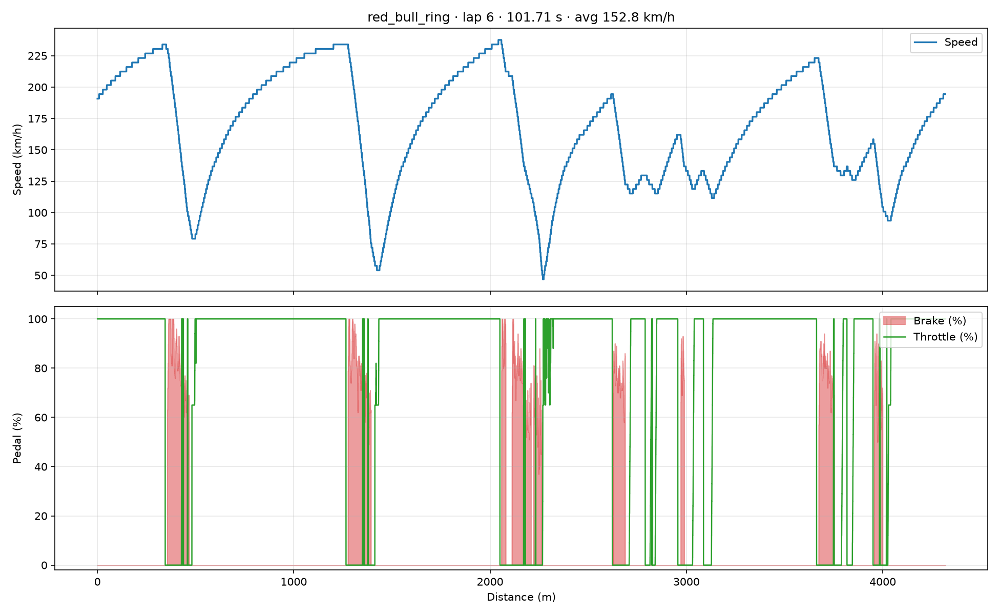
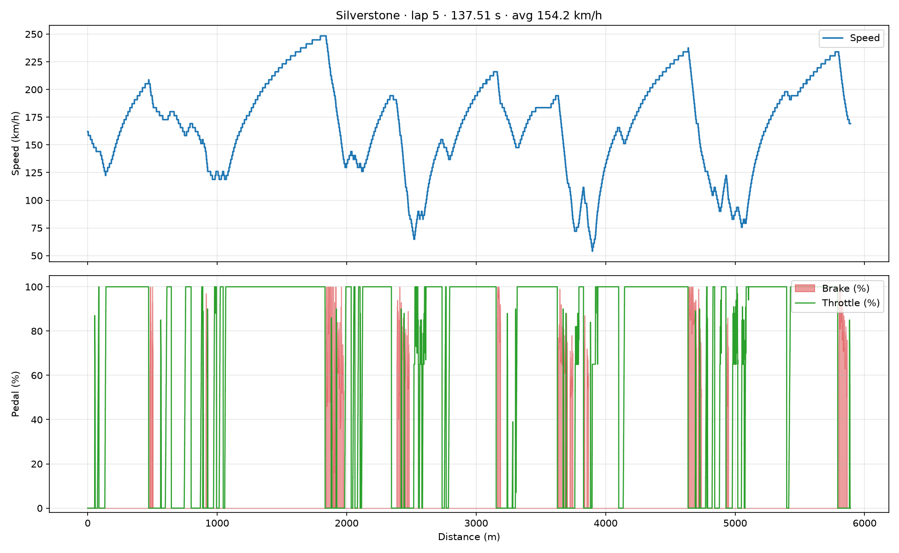
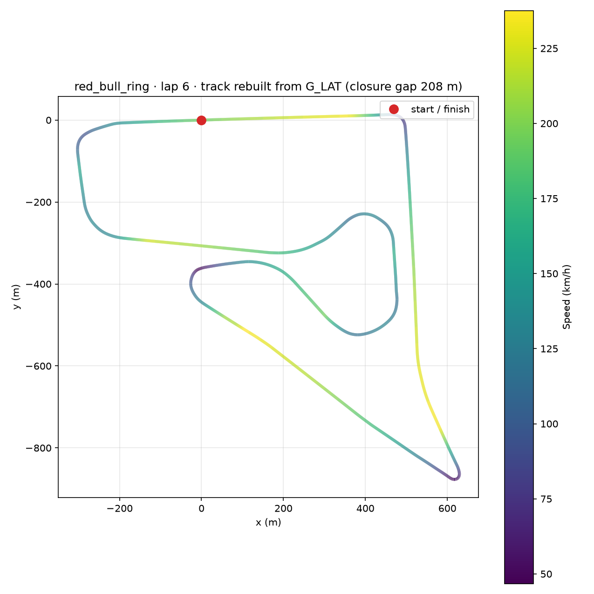
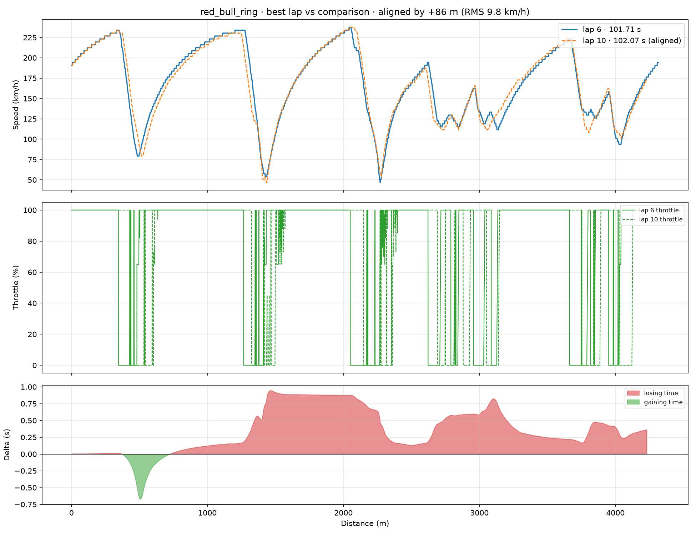

# Project 01 — Lap detection and telemetry baseline

Turn a raw MoTeC CSV log into laps, a lap table and a readable speed/throttle/brake trace.

## Overview

A MoTeC export from Assetto Corsa Competizione is a 200 Hz table of channels with no lap markers: `LAP_BEACON` is constant, there is no lap counter, and the time channel starts at an arbitrary moment. Before any analysis you have to answer a basic question — **where does one lap end and the next begin?**

This project answers it by rebuilding distance from the speed channel and slicing the session into segments of exactly one track length.

## Data

| | Red Bull Ring | Silverstone |
|---|---|---|
| Car | Mercedes-AMG GT3 Evo | Porsche 992 GT3 R |
| Duration | 1105.7 s | 829.6 s |
| Samples | 221 137 | 165 917 |
| Sample rate | 200 Hz | 200 Hz |
| Distance | 43.30 km | 34.93 km |
| Laps found | 10 | 5 |

Channels used: `Time`, `SPEED`, `THROTTLE`, `BRAKE`, `GEAR`.

## Method

1. **Read the header by content, not by line number.** The export has a metadata block on top; the script looks for the line whose first field is `Time`. Field names, units and the track name (`Venue`) come from that block.
2. **Rebuild distance.** `distance = cumsum(speed × dt)`. The single `NaN` cell in `SPEED` is interpolated first — otherwise one empty cell turns the whole distance channel into `NaN`.
3. **Slice laps by distance.** Boundaries are placed where the reconstructed distance crosses multiples of the track length (4318 m and 5891 m). The trailing partial segment is discarded.
4. **Align laps before comparing** (see below).
5. **Plot.** Speed and pedals against distance, not time — that is the only way two laps line up.

## Results

### Red Bull Ring

| Lap | Time (s) | Avg (km/h) | Max (km/h) | Full throttle (%) | Braking (%) |
|-----|----------|------------|------------|-------------------|-------------|
| 1 | 116.00 | 134.0 | 234.0 | 55.1 | 9.9 |
| 2 | 116.78 | 133.1 | 234.0 | 58.1 | 10.5 |
| 3 | 105.71 | 147.1 | 230.4 | 61.6 | 11.4 |
| 4 | 110.90 | 140.2 | 234.0 | 62.3 | 10.8 |
| 5 | 102.56 | 151.6 | 234.0 | 64.7 | 11.2 |
| **6** | **101.71** | **152.8** | 237.6 | 69.9 | 14.4 |
| 7 | 114.79 | 135.4 | 237.6 | 59.9 | 12.2 |
| 8 | 119.19 | 130.4 | 237.6 | 62.2 | 13.3 |
| 9 | 113.70 | 136.7 | 241.2 | 62.3 | 13.4 |
| 10 | 102.07 | 152.3 | 237.6 | 68.9 | 16.3 |



### Silverstone

Best lap: **137.51 s** (154.2 km/h average), 5 complete laps found.



## Track map

The log has no GPS and no X/Y position, so the circuit is rebuilt from the lateral
acceleration channel:

- curvature `kappa = a_lat / v²`;
- integrating curvature over distance gives the heading;
- integrating the heading gives x and y.



Integrating a quantised channel always drifts, so the loop is closed in two steps:
the heading is scaled to exactly one full turn, and the remaining position gap is
spread evenly over the lap. The gap before correction is printed in the plot title:
**208 m on a 4318 m lap (4.8 %)**.

The outline is recognisable and the speed colouring follows the expected pattern —
top speed at the end of the straights, minimum speed in the slow corners. On longer
laps the drift grows: the Silverstone reconstruction closes with 6.9 % error and its
shape is noticeably stretched.

## Key finding

Lap 6 is the best lap of the Red Bull Ring session. Comparing it with lap 10 — only **0.36 s** slower overall — shows that the two laps are far from identical:



- In the first corner the compared lap **gains 0.67 s**.
- Between roughly 1400 m and 2200 m it **loses 0.95 s**.
- From 2200 m to the end the two laps are nearly equal.

Net: 0.36 s. A driver reading only the lap time would see "almost identical laps". A driver reading the delta sees two completely different corners — one where the car is quick and one where the time disappears.

## Why the alignment matters

The first version of this chart swung by ±2.5 s even though the total difference was 0.36 s. That is not a real time loss — it is a **phase error**.

Distance is reconstructed from speed, and speed in the log is rounded, so the integration drifts: after a few laps, "lap N" starts tens of metres away from "lap N-1". Comparing the raw traces then compares different parts of the track.

The fix is a one-dimensional search: shift the compared lap by −250…+250 m and pick the offset with the lowest RMS difference between the speed profiles. For this session the optimum is **+86 m**, and the RMS error drops from 38 km/h to 9.8 km/h. After that the delta curve becomes stable and the slope correction needed to keep both endpoints correct is small.

A delta that oscillates with the same period as the lap is almost always a synchronisation problem, not a driving problem.

## Limitations

- Lap boundaries are derived from integrated distance, so the first and last laps of a session may be partial. They are kept only if a full track length fits.
- The track length must be known. It is looked up by venue name or passed with `--track-length`.
- Alignment by speed profile assumes the two laps are driven on a similar line. With traffic or a big off-track, the offset can be wrong.
- The delta is normalised to 0 at the start and to the real lap difference at the end. The shape in between is correct; the absolute offset depends on that normalisation.
- Throttle and brake are plotted raw, without smoothing: the steps are the signal, not noise.
- The track map is rebuilt from a quantised lateral acceleration channel, not from a position log. The loop is closed artificially, so the outline is representative rather than exact.

## How to run

On Windows there is no need for a terminal:

| File | What happens |
|------|--------------|
| `run_analysis.bat` | console window, progress and summary, then the results folder opens |
| `run_silent.vbs` | no window at all; the analysis runs in the background and the results folder opens |

Both launchers call Python 3.11 explicitly, because plain `python` can resolve to the
Microsoft Store stub, which exits successfully without doing anything.

```bash
pip install -r requirements.txt

# every CSV in ./data
python analyze.py

# explicit files or folders
python analyze.py --data data/data.csv data/data1.csv
python analyze.py --data logs/
```

| Flag | Meaning | Default |
|------|---------|---------|
| `--data` | CSV files or folders | every CSV in `./data` |
| `--out` | output folder | `docs` |
| `--track-length` | override the track length in metres | read from the `Venue` field |
| `--no-compare` | skip the delta plot | off |

Each session writes `laps.csv`, `best_lap.png` and `delta.png` into `docs/<venue>/`.

Raw logs are **not stored in this repository**: `data/*.csv` is ignored by git.
Put your own MoTeC exports into `data/` — the expected format is described in
[`data/README.md`](data/README.md).

## What I learned

- A lap is a distance, not a duration.
- Speed is the base channel: everything else (distance, lap boundaries, delta) is derived from it.
- Two charts that look right can still be wrong — the ±2.5 s delta was a bug that looked like a finding.
- Units matter: `SPEED` is m/s, `BRAKE` is 0–100 %, not a boolean.
